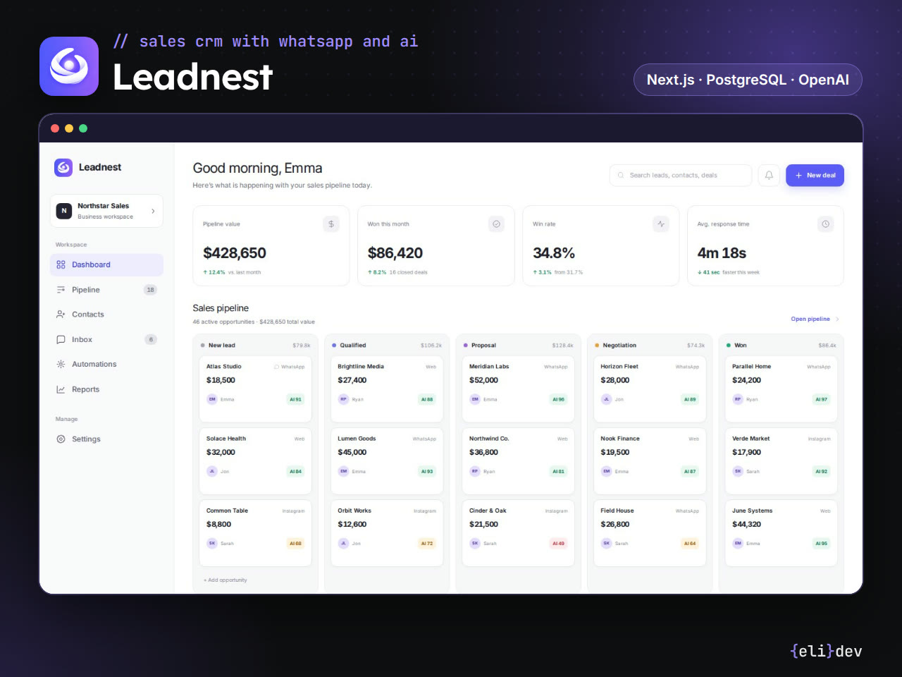
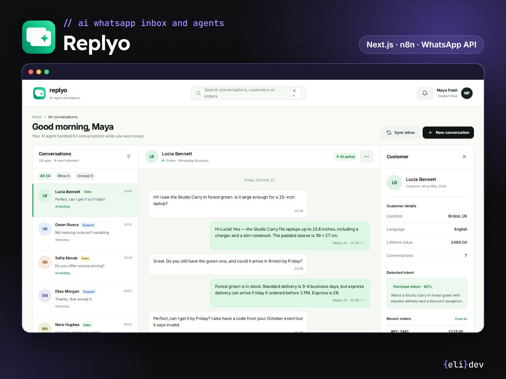
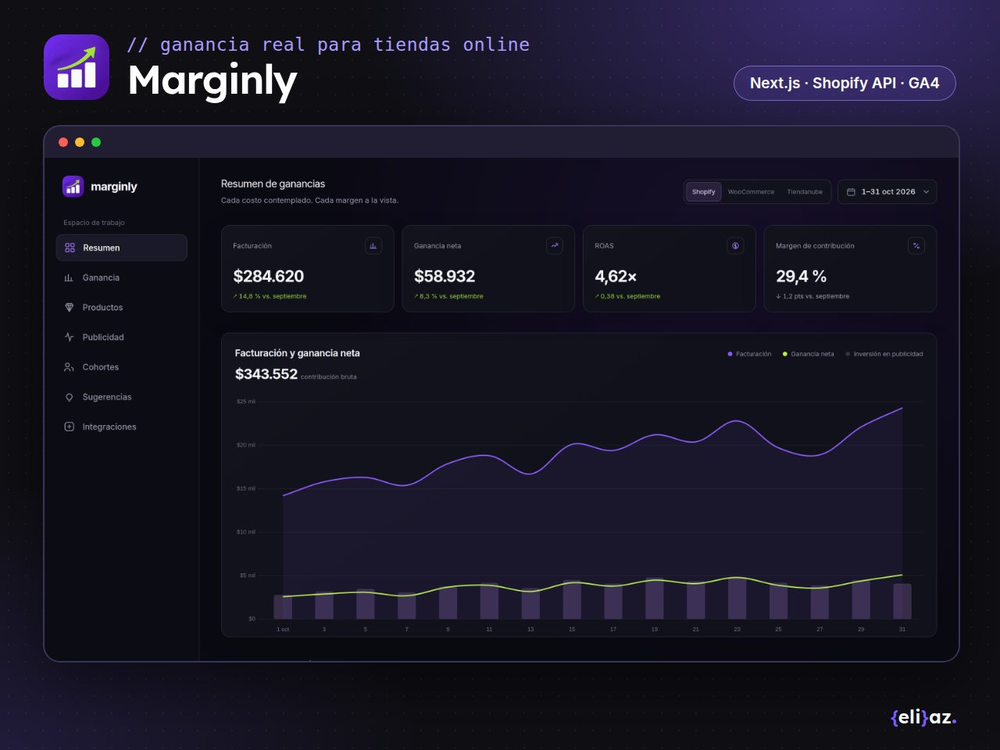
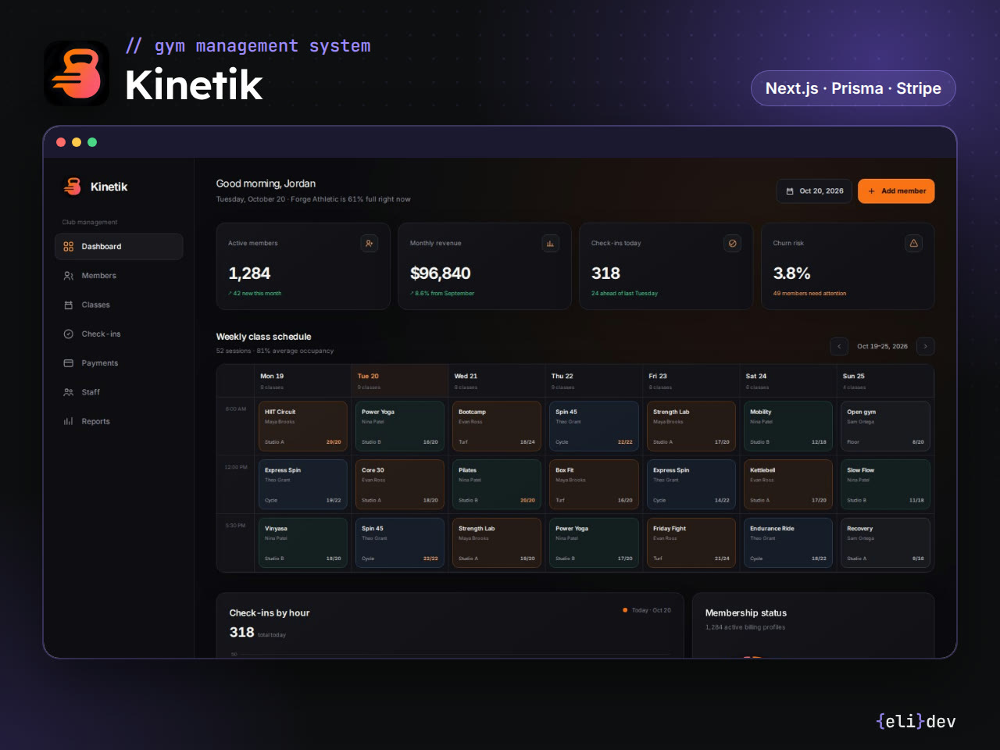
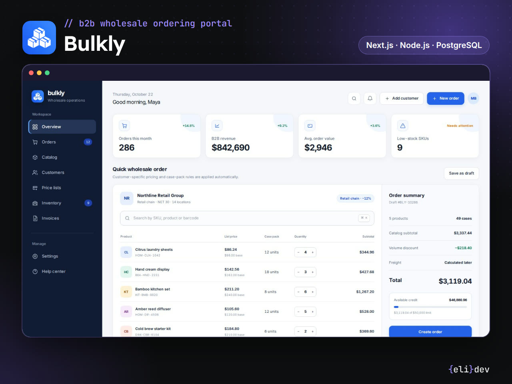
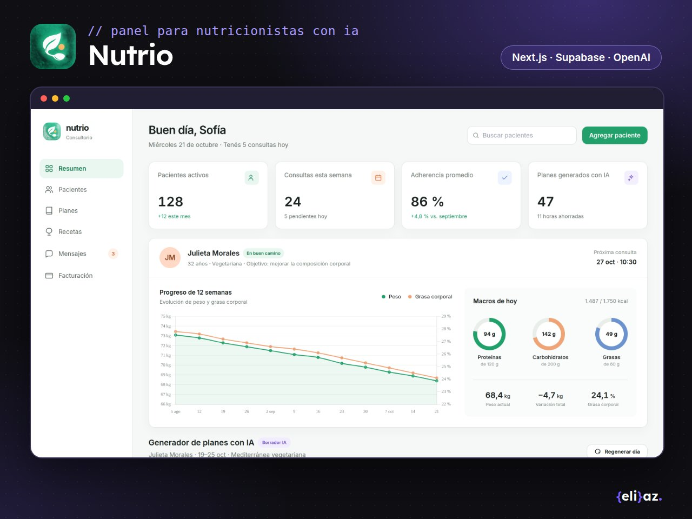
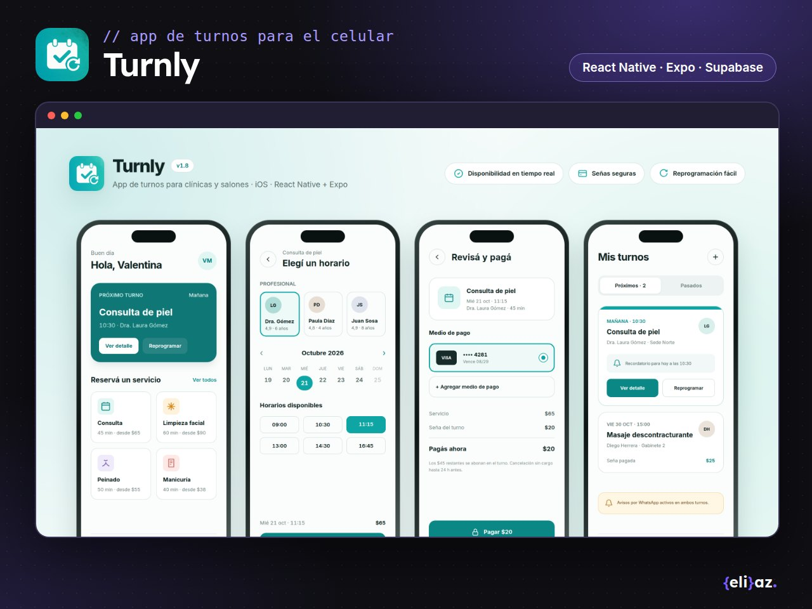

# Conceptos de producto

**7 paneles de producto SaaS diseñados como concepto:** CRM con WhatsApp e IA, inbox con agentes, analítica de ganancia, gimnasio, mayorista B2B, nutricionistas y app de turnos.

Product concepts: 7 SaaS dashboards with invented brands and sample data.

> [!NOTE]
> **Son conceptos, no trabajos para clientes.** Las marcas, las personas y los datos son inventados. Muestran cómo encaro un panel de producto: qué información va primero, cómo se lee de un vistazo y qué hace la IA en cada caso.

## Los paneles

<table>
<tr>
<td width="50%" valign="top"> <b>Leadnest</b> · CRM de ventas con WhatsApp e IA Pipeline kanban con canal y puntaje de IA en cada oportunidad, gráficos de ingresos y conversión, y un resumen de cada conversación con la intención, el presupuesto y el próximo paso. <i>Stack previsto: Next.js · PostgreSQL · OpenAI</i> <a href="https://orbitalnestdev.github.io/saas-concepts/leadnest.html">Ver panel →</a></td>
<td width="50%" valign="top"> <b>Replyo</b> · Inbox de WhatsApp con agentes de IA El agente responde desde una base de conocimiento, agenda turnos y pasa la consulta a una persona con todo el contexto. Bandeja compartida, panel del cliente, constructor visual de agentes al estilo n8n y métricas de respuestas IA vs. humanas. <i>Stack previsto: Next.js · n8n · WhatsApp Cloud API</i> <a href="https://orbitalnestdev.github.io/saas-concepts/replyo.html">Ver panel →</a></td>
</tr>
<tr>
<td width="50%" valign="top"> <b>Marginly</b> · Analítica de ganancia para tiendas online Ganancia neta real después de costo, envío, comisiones y publicidad para Shopify, WooCommerce y Tiendanube: ROAS por día, cascada de ganancia, productos que pierden plata e ideas de la IA con su impacto estimado. <i>Stack previsto: Next.js · Shopify API · Meta Ads · GA4</i> <a href="https://orbitalnestdev.github.io/saas-concepts/marginly.html">Ver panel →</a></td>
<td width="50%" valign="top"> <b>Kinetik</b> · Sistema de gestión para gimnasios Socios y membresías, grilla semanal de clases con cupos, ingresos por hora, pagos y una lista de socios en riesgo que dejaron de ir, con recordatorio por WhatsApp en un clic. <i>Stack previsto: Next.js · Prisma · Stripe</i> <a href="https://orbitalnestdev.github.io/saas-concepts/kinetik.html">Ver panel →</a></td>
</tr>
<tr>
<td width="50%" valign="top"> <b>Bulkly</b> · Portal de pedidos mayoristas (B2B) El cliente hace pedidos rápidos por SKU con su lista de precios, mínimos por bulto y crédito disponible; el equipo maneja listas por segmento, stock por depósito y cada pedido desde la preparación hasta la factura. <i>Stack previsto: Next.js · Node.js · PostgreSQL</i> <a href="https://orbitalnestdev.github.io/saas-concepts/bulkly.html">Ver panel →</a></td>
<td width="50%" valign="top"> <b>Nutrio</b> · Panel para nutricionistas con planes de IA Fichas de pacientes con evolución de peso y grasa corporal, macros del día, armado del plan semanal con IA y registro de comidas por foto analizado por IA. <i>Stack previsto: Next.js · Supabase · OpenAI</i> <a href="https://orbitalnestdev.github.io/saas-concepts/nutrio.html">Ver panel →</a></td>
</tr>
<tr>
<td width="50%" valign="top"> <b>Turnly</b> · App de turnos para iOS Para clínicas y salones: el cliente elige servicio, profesional y horario, paga una seña y recibe recordatorios; el negocio tiene un back office web con la agenda del día, la ocupación y los ingresos. <i>Stack previsto: React Native · Expo · Supabase</i> <a href="https://orbitalnestdev.github.io/saas-concepts/turnly.html">Ver panel →</a></td>
<td width="50%"></td>
</tr>
</table>

## Cómo están hechos

- Cada panel es un solo archivo HTML: Tailwind por CDN, Chart.js para los gráficos e íconos SVG en línea. Sin build ni dependencias.
- Diseñados a 1440 px de ancho, con datos de ejemplo de octubre de 2026.
- El stack de cada ficha es el que usaría para construir el producto real.
- Diseño y especificación propios; el maquetado se hizo con asistencia de IA.

## Verlos en tu compu

Cloná el repo y abrí `index.html` en el navegador. No hace falta instalar nada.

---

Hecho por <a href="https://github.com/orbitalnestdev">Eliana Azcurra</a> · desarrolladora full stack freelance · <a href="https://www.linkedin.com/in/eliazdev">LinkedIn</a> · <a href="https://www.fiverr.com/elyazcurra90">Fiverr</a>

